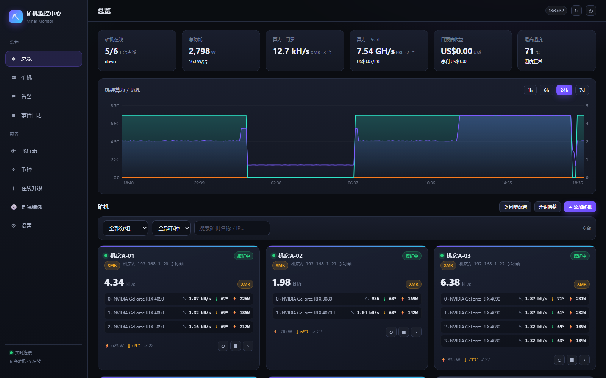
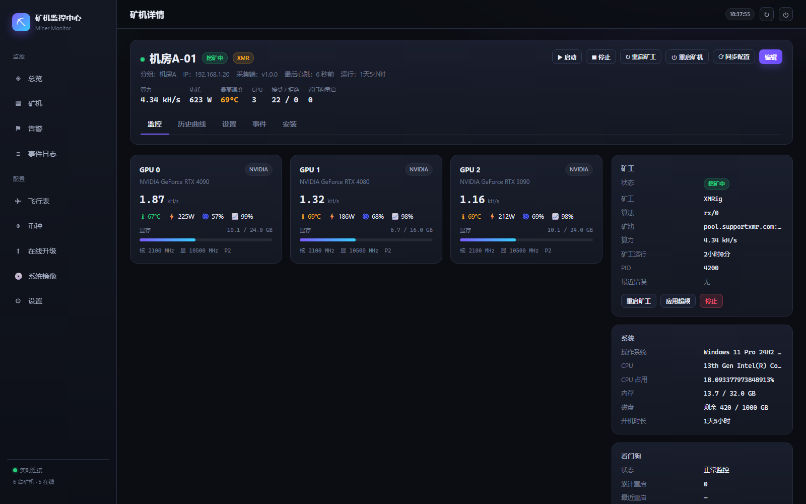
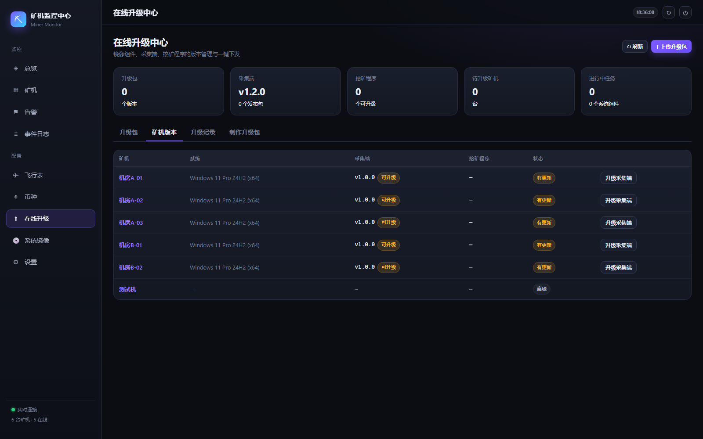
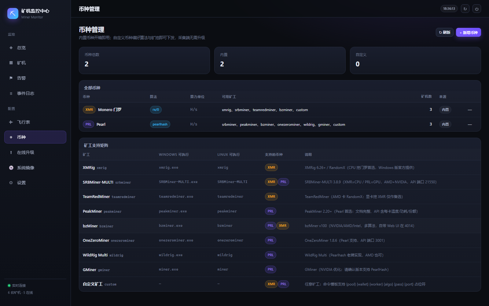
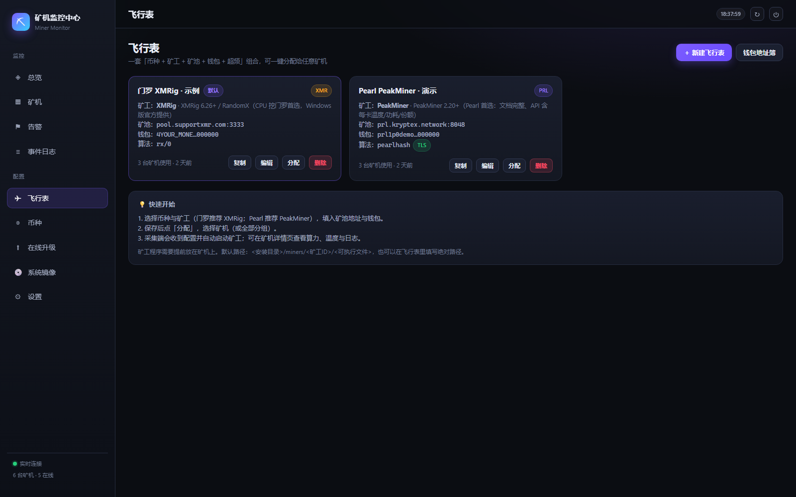
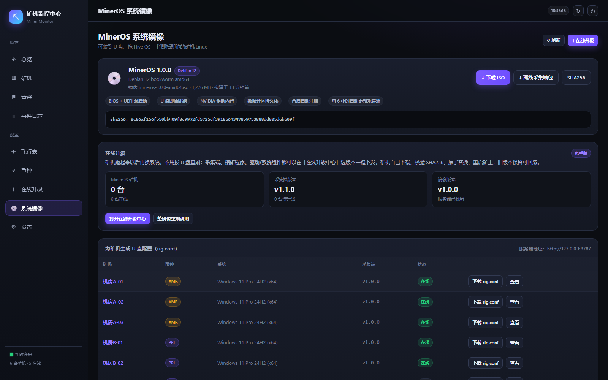

# ⛏ 矿机监控中心（Miner Monitor）

一套 **Windows / Linux 矿机集中监控与远程管理系统**，界面模仿 Hive OS 的深色仪表盘，专门针对 **Monero（门罗 XMR）** 与 **Pearl（PRL）** 挖矿。

- **零第三方依赖**：只需要 Node.js（≥ 22.5，内置 `node:sqlite`），服务端和采集端都不需要 `npm install`。
- **服务端**：Web 控制台 + REST API + WebSocket 实时推送 + SQLite 存储。
- **采集端**：一套代码同时跑 **Windows** 和 **Linux（MinerOS）**，读取 `nvidia-smi`/`amdgpu sysfs`、识别矿工进程、轮询矿工 API/日志，并执行远程命令。
- **MinerOS**：可烧到 U 盘、像 Hive OS 一样即插即跑的矿机 Linux（Debian 12 定制），开机自动注册、数据分区持久化、每 6 小时自动更新采集端。
- **开箱即用**：Windows 一条 PowerShell 命令安装采集端；Linux 烧 U 盘后插上即可。

---

## 功能总览

| 模块 | 能力 |
|---|---|
| 总览 | 机群在线数、总算力（按币种）、总功耗、日收益估算、最高温度、机群算力/功耗曲线 |
| 矿机卡片 | 每卡算力 / 温度 / 风扇 / 功耗、接收/拒绝份额、矿工状态、在线时长、快捷操作 |
| 矿机详情 | GPU 卡片、矿工信息与日志、看门狗、系统信息、历史曲线（整机 + 每卡）、事件时间线、安装脚本 |
| 飞行表 | 「币种 + 矿工 + 矿池 + 钱包 + 超频 + 看门狗」组合，一键批量分配；内置 XMRig / PeakMiner / SRBMiner / bzMiner / OneZero / WildRig / 自定义矿工参数模板（自动区分 Windows/Linux 可执行文件） |
| 远程命令 | 启动 / 停止 / 重启矿工、重启/关机、同步配置、应用超频、远程更新采集端、自定义 PowerShell / sh（需本机允许） |
| 看门狗 | 矿工崩溃自动重启、算力骤降/掉零重启、过热自动停机、重启频率保护 |
| 告警 | 离线、温度、算力下降、矿工未运行、功耗、拒绝率；持续时长、作用范围（全机群/矿机/分组/币种）、Telegram / Discord / Webhook / 站内通知 |
| 历史 | 10 秒级 GPU 采样，5 分钟聚合，默认保留 7 天明细 / 90 天聚合，自动清理 |
| **系统镜像** | **MinerOS 管理页：ISO 下载 + SHA256、离线采集端包、按矿机生成 rig.conf、烧录/部署指引** |
| **在线升级** | **镜像组件 / 采集端 / 挖矿程序在线升级：上传或自动扫描升级包、按矿机/平台下发、SHA256 校验、原子替换、进度回传、失败可回滚，不用重装 U 盘** |
| **币种扩展** | **内置 XMR / PRL；控制台可自定义新币种（代号/算法/单位/兼容矿工），飞行表立即可选，矿机端无需升级** |
| 部署 | Windows 一键脚本（Node + 计划任务）；MinerOS 烧 U 盘后自动注册；密钥重置；离线补发命令 |
| 其它 | 钱包地址簿、备份导出/恢复、管理员密码修改、事件日志、维护模式 |

---

## 界面预览

| 总览（机群算力 / 功耗 / 收益 / GPU 明细） | 矿机详情（历史曲线 / 矿工日志 / 远程命令） |
| --- | --- |
|  |  |

| 在线升级中心（版本矩阵 / 一键下发） | 币种管理（内置 + 自定义） |
| --- | --- |
|  |  |

| 飞行表 | 系统镜像（MinerOS + 在线升级入口） |
| --- | --- |
|  |  |

> 截图由 `node .tools/shots.mjs` / `node .tools/shots-updates.mjs` 真实浏览器渲染生成。

---

## 快速开始

### 1. 启动服务端（一台常开的电脑 / 服务器 / 群晖 NAS 均可）

要求：**Node.js ≥ 22.5**（推荐 24 LTS）。

```powershell
cd web-miner-monitor
node server/app.js
```

首次启动会：

1. 在 `data/` 下创建 SQLite 数据库；
2. 生成管理员账号，并把密码写入 `data/初始管理员密码.txt`（也可以启动前设置环境变量 `MM_ADMIN_PASSWORD`）；
3. 在控制台打印访问地址（默认 `http://127.0.0.1:8787`，同时监听局域网 IP）。

> 端口被占用会自动顺延（8787 → 8788 …）。用 `MM_PORT` 可指定端口。

### 2. 登录控制台

浏览器打开 `http://<服务器IP>:8787`，用 `admin` + 初始密码登录，然后：

1. 去 **设置 → 安全** 修改密码；
2. 去 **设置 → 基础设置** 填「服务器公网地址」（用于生成安装脚本，例如 `http://192.168.1.10:8787`）。

### 3. 添加矿机 + 安装采集端

有两种方式：

**A. 自动注册（推荐）**
在任意矿机上以管理员身份打开 PowerShell，执行：

```powershell
# 到控制台「矿机 → 添加矿机 → 复制安装脚本」拿完整脚本，核心就是：
powershell -ExecutionPolicy Bypass -File install.ps1
```

采集端会上报机器指纹并自动出现在「待分组」里，之后在控制台改名字、分组、分配飞行表即可。

**B. 手动创建矿机**
「矿机 → 添加矿机」→ 创建后自动弹出安装脚本 → 在矿机上执行。脚本会：

- 检查/安装 Node.js（如果没有）
- 下载采集端到 `C:\ProgramData\MinerMonitor`
- 写入带密钥的 `config.json`
- 注册计划任务 `MinerMonitorAgent`（SYSTEM 权限、开机自启、失败自动重启）

### 3.5 用 MinerOS（Linux）替代 Windows：烧 U 盘即用

不想装 Windows 的矿机可以直接跑 **MinerOS**（本项目的 Linux 发行版，Debian 12 定制）：

```powershell
# 1) 构建镜像（WSL2 / Docker，一次约 20-40 分钟）
.\os\tools\build.ps1
# 2) 烧到 U 盘（管理员，16GB+）
.\os\tools\flash-usb.ps1 -Iso .\os\dist\mineros-1.0.0-amd64.iso
# 3) 写这台矿机的 rig.conf（控制台「系统镜像」页也能下载）
.\os\tools\make-rigconf.ps1 -Server http://192.168.1.10:8787 -RigName 机房A-01
```

插到矿机、BIOS 设 USB 启动，30 秒后自动注册上线；屏幕显示 IP，浏览器打开 `http://<IP>:4000` 可看本地面板。
详见 [docs/MinerOS镜像说明.md](docs/MinerOS镜像说明.md)。

### 4. 准备矿工程序

采集端不会自动下载矿工（矿工版本与显卡驱动关系密切，建议自己放）。把矿工放到矿机上，例如：

```
C:\ProgramData\MinerMonitor\miners\xmrig\xmrig.exe
C:\ProgramData\MinerMonitor\miners\peakminer\peakminer.exe
```

或在飞行表的「矿工」区域填写**绝对路径**。

| 币种 | 推荐矿工 | 下载 |
|---|---|---|
| XMR | **XMRig 6.26+**（CPU 挖 RandomX） | https://github.com/xmrig/xmrig/releases |
| PRL | **PeakMiner 2.20+**（GPU，API 最完整） | https://github.com/peakminer/peakminer/releases |
| PRL 备选 | SRBMiner-MULTI 3.8.9 / bzMiner / OneZeroMiner / WildRig | 各自 GitHub Releases |
| 通用 | 自定义矿工（命令模板） | — |

### 5. 创建飞行表并分配

「飞行表 → 新建飞行表」：

1. 选币种 → 选矿工（自动带出默认参数与 API 端口）
2. 矿池：从预设里选，或手填 `host:port`；TLS 按矿池要求勾选
3. 钱包地址（可先在「钱包地址簿」保存）
4. 可选：功耗上限、频率偏移、风扇、温度上限、算力下降阈值
5. 保存 → 「分配」→ 勾选矿机 → 应用

采集端收到配置后会按需重启矿工，10 秒内即可在总览看到算力。

---

## 项目结构

```
web-miner-monitor/
├── server/                 # 服务端（零依赖）
│   ├── app.js              # 入口：HTTP + WebSocket + 定时任务
│   ├── db.js               # SQLite 表结构与查询
│   ├── collector.js        # 采集端心跳处理、遥测入库、广播
│   ├── api.js              # REST API
│   ├── alerts.js           # 告警规则引擎 + 通知
│   ├── history.js          # 历史聚合与清理
│   ├── network.js          # 行情与全网算力（失败自动降级）
│   ├── auth.js             # 会话 / 密码 / 矿机密钥
│   ├── bundle.js           # 采集端打包下载 + 安装脚本生成
│   ├── events.js           # 进程内事件总线 + WebSocket 广播
│   └── http.js             # HTTP 工具、静态文件、路由
├── agent/                  # 采集端（Windows）
│   ├── agent.js            # 主循环：心跳、命令、配置、看门狗
│   ├── gpu.js              # nvidia-smi / AMD 性能计数器
│   ├── miner.js            # 矿工进程管理 + 各矿工 API 解析
│   ├── watchdog.js         # 崩溃/算力/温度保护
│   ├── sys.js              # CPU/内存/磁盘/网络
│   └── proc.js             # 外部命令执行封装
├── shared/                 # 服务端与采集端共用
│   ├── miners.js           # 币种/矿工目录、启动参数、矿池预设
│   ├── util.js             # 工具函数、口令哈希
│   └── ws.js               # 零依赖 WebSocket 实现
├── web/                    # 控制台前端（原生 ES Module，无构建）
│   ├── index.html
│   ├── css/style.css
│   └── js/{app,api,store,realtime,chart,components,dom}.js + pages/
├── scripts/
│   └── demo-rigs.js        # 生成演示数据（6 台矿机 + 6 小时历史）
├── tests/
│   ├── e2e.mjs             # 端到端联调（服务端 + 采集端 + 假矿工）
│   └── fake-xmrig.js       # 测试用假矿工 API
├── os/                     # MinerOS：矿机 Linux 发行版
│   ├── build/              # 构建脚本（build.sh / Docker / 镜像自检）
│   ├── live-build/         # live-build 配置：包清单、钩子、systemd、首启脚本
│   ├── tools/              # Windows 工具：build/flash-usb/make-rigconf/provision-usb
│   └── dist/               # 构建产物（ISO、离线采集端包、rig.conf）
├── docs/                   # 使用说明与挖矿知识
└── data/                   # 运行时数据（数据库、日志、初始密码）
```

---

## 配置

### 服务端

环境变量（也可写在项目根目录 `config.json`）：

| 变量 | 默认 | 说明 |
|---|---|---|
| `MM_HOST` | `0.0.0.0` | 监听地址 |
| `MM_PORT` | `8787` | 端口（被占用自动 +1） |
| `MM_DATA_DIR` | `./data` | 数据目录 |
| `MM_ADMIN_USER` | `admin` | 管理员账号（仅首次创建时生效） |
| `MM_ADMIN_PASSWORD` | 随机 | 管理员密码（仅首次创建时生效） |
| `MM_PUBLIC_URL` | — | 安装脚本里使用的地址 |
| `MM_AGENT_AUTO_REGISTER` | `true` | 是否允许采集端自动注册 |

### 采集端

`config.json`（安装脚本自动生成）：

```json
{
  "serverUrl": "http://192.168.1.10:8787",
  "token": "rig_xxx",
  "rigId": "xxx",
  "name": "矿机名",
  "intervalSec": 5,
  "allowReboot": true,
  "allowRun": true,
  "minerPath": "C:\\ProgramData\\MinerMonitor\\miners"
}
```

| 字段 | 说明 |
|---|---|
| `token` / `rigId` | 安装脚本写入；也可留空 + 开启自动注册 |
| `intervalSec` | 心跳间隔（服务端可下发覆盖） |
| `allowReboot` | 是否允许远程重启/关机 |
| `allowRun` | 是否允许执行自定义 PowerShell 命令 |
| `minerPath` | 矿工根目录（可选） |

采集端命令行：

```powershell
node agent\agent.js --config C:\ProgramData\MinerMonitor\config.json   # 正常运行
node agent\agent.js --check                                           # 自检（GPU/网络/注册状态）
node agent\agent.js --simulate --once                                 # 模拟上报一次（联调用）
node agent\agent.js --help                                            # 帮助
```

---

### MinerOS 采集端配置

`/etc/mineros/agent.json`（首启脚本根据 U 盘 `rig.conf` 生成）：

```json
{
  "serverUrl": "http://192.168.1.10:8787",
  "token": "rig_xxx 或留空自动注册",
  "rigId": "xxx",
  "name": "机房A-01",
  "workDir": "/var/lib/mineros",
  "minerPath": "/opt/mineros/miners",
  "intervalSec": 5,
  "allowReboot": true,
  "allowRun": true,
  "allowUpdate": true
}
```

U 盘根目录 `rig.conf`（Hive OS 风格）：

```ini
SERVER_URL=http://192.168.1.10:8787
RIG_NAME=机房A-01
ALLOW_REBOOT=true
ALLOW_RUN=true
RIG_PASSWD=rig_xxx     # 可选
RIG_ID=xxx             # 可选
```

## 安全建议

- 控制台默认监听 `0.0.0.0` 且是 **HTTP**。请只在可信内网使用；如需公网访问，建议放在 **反向代理 + HTTPS** 后面（Nginx/Caddy），并保持控制台会话 Cookie 的 `Secure`（设置 `MM_HTTPS=true`）。
- 管理员密码用 scrypt 哈希存储；矿机密钥可随时在矿机详情页重置。
- 采集端以 **SYSTEM** 运行（远程重启、`nvidia-smi -pl` 需要管理员权限）。如不需要远程重启，把 `allowReboot` 设为 `false`。
- 「自定义命令」默认允许，如无需要把 `allowRun` 设为 `false`。
- 备份 JSON 含矿机密钥，请妥善保管。

---

## 常见问题

**Q：矿机在线但看不到 GPU？**
采集端用 `nvidia-smi` 读取 NVIDIA 卡。请确认驱动正常：在矿机上运行 `nvidia-smi`。AMD 卡只能取到利用率/显存，温度/功耗需矿工 API 上报（PeakMiner 支持）。

**Q：矿机显示「未挖矿」/ 算力为 0？**
检查飞行表是否已分配、矿工路径是否正确、矿机是否处于「启用」且非「维护模式」。矿机详情页的「矿工日志」会显示启动错误。

**Q：Pearl 算力数值为什么比别的币小很多？**
PearlHash 是 ZK 证明式 PoW，每份 share 都要生成 STARK 证明，数值本身比 KawPow 等算法小几个数量级，属正常现象。

**Q：改了飞行表，矿机没反应？**
采集端每 5 秒心跳都会取最新配置并比较哈希；只有配置变化时才会重启矿工。可点「同步配置」强制刷新，或看矿机详情页的看门狗/事件记录。

**Q：矿机离线时下发的命令会丢吗？**
不会。命令会排队，矿机上线后的第一次心跳就会领取并执行，结果回传后记录在「事件日志」。

**Q：怎么备份/迁移？**
「设置 → 数据与备份 → 导出备份 JSON」；新服务器导入后用同一份采集端密钥即可（或重新生成安装脚本）。

**Q：MinerOS 和 Windows 采集端有什么区别？**
协议完全一致，控制台无差别管理。MinerOS 额外提供：U 盘即插即跑、内置 NVIDIA 驱动与 Node、tty1 状态面板、`:4000` 本地控制台（含 WiFi 配置）、每 6 小时自动更新、数据分区持久化（重刷镜像不丢配置/矿工）。

**Q：MinerOS 镜像必须自己构建吗？**
ISO 需要在 Linux 环境（WSL2/Docker/Debian）构建，仓库提供 `os/build/build.sh` 与 Windows 一键 `os\tools\build.ps1`。控制台的「系统镜像」页会展示构建状态与下载入口。

**Q：MinerOS 的数据放在哪？**
有 `MINEROS-DATA` 数据分区时：`/data/etc`（配置）、`/data/state`（采集端状态/日志）、`/data/miners`（矿工）；没有时用 tmpfs，重启会丢。

**Q：数据存在哪？**
`data/monitor.sqlite`（SQLite，WAL 模式），日志在 `data/logs/`。直接复制整个 `data/` 目录即可迁移。

---

## 开发与测试

```bash
# 端到端：服务端 + 采集端 + 假矿工 API
node tests/e2e.mjs http://127.0.0.1:8787

# 生成演示数据（6 台模拟矿机 + 6 小时历史曲线）
node scripts/demo-rigs.js
```

前端是原生 ES Module，改完刷新浏览器即可，没有构建步骤。

更多细节见：

- [`docs/采集端使用说明.md`](docs/采集端使用说明.md) — 部署、排错、矿工放置
- [`docs/挖矿知识与参数.md`](docs/挖矿知识与参数.md) — 两个币种的算法、矿池、矿工参数、API 字段、收益公式
- [`docs/在线升级与币种扩展.md`](docs/在线升级与币种扩展.md) — 在线升级中心、升级包制作、下发与回滚、新增币种、整镜像重刷

---

## 许可

MIT
